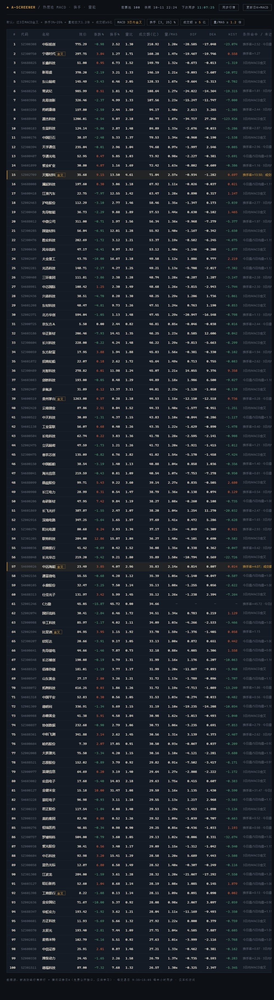

# a-stock-screener · A股免费数据定时同步 + 条件筛选

本地看板：交易时段每 **30 分钟**同步热度前 **100** 只 A 股（成交额排名）的公开行情，
收盘后统一补日 K 并重算 **MACD(12,26,9)**，支持按 **MACD / 换手率 / 量能 / 涨跌幅 /
成交额 / 现价** 组合条件自动筛选。暗色 Web 看板，可开机静默自启。

> 数据源均为免费公开接口，仅供学习研究，不构成投资建议。



## 数据源（免费）

| 用途 | 接口 | 说明 |
|---|---|---|
| 热度池 + 实时快照 | 新浪 `Market_Center.getHQNodeData`（hs_a，按成交额降序） | 一次请求取前 100，含换手率/PE/流通市值 |
| 量比/振幅/行情日期 | 腾讯 `qt.gtimg.cn` 批量行情（GBK，60 只/批） | 增强失败不阻断主链路 |
| 前复权日 K | 腾讯 `web.ifzq.gtimg.cn/fqkline` | 200 根；量主板/创业板为手，科创板 688/689 为股（解析层自动归一） |
| 日 K 兜底 | 新浪 `getKLineData`（不复权） | 腾讯失败/根数异常时切换 |

**为什么不用 akshare/东方财富**：实测 `push2.eastmoney.com` 在本机对所有 Python HTTP
客户端（requests / httpx / curl_cffi 伪装 Chrome 指纹）直接掐断 TLS，故数据源直连
新浪 + 腾讯，依赖只有 requests / fastapi / uvicorn。

## 同步节奏（交易日）

```
09:35 10:05 10:35 11:05 11:35 13:05 13:35 14:05 14:35 15:05  行情快照（比整点晚5分钟等落数）
15:20                                                          100只日K + MACD
```

- 周末/节假日：用腾讯返回的行情日期判定休市，记 `closed`，不落脏数据
- 错过槽位（电脑关机）：开机后只补一次取数，其余槽位记 `skipped`，不补打
- 调度内置于 Web 进程（30 秒唤醒检查），也可 `python -m ascreener sync` 手动跑

## 使用

```bat
:: 首次初始化（周末加 --ignore-closed 取上一交易日数据，约 1~2 分钟）
python -m ascreener sync --all --ignore-closed

:: 启动看板（前台调试）
serve.bat                         :: http://127.0.0.1:8772

:: 后台无窗口起服务并自动开浏览器（双击即可）
python launch.py

install-autostart.bat             :: 开机自启（启动文件夹 VBS，纯 ASCII）
uninstall-autostart.bat           :: 卸载
```

## 怎么改筛选条件

编辑 **`data/screen_config.json`**（首次运行自动生成），刷新页面即生效，无需重启：

```json
{
  "name": "近3日金叉 + 换手3~25% + 量能放大1.2倍 + 成交额≥5亿",
  "macd": { "golden_cross_within": 3, "dif_gt0": false },
  "turnover_rate": { "min": 3, "max": 25 },
  "vol_vs_ma5": { "min": 1.2 },
  "amount_yi": { "min": 5 }
}
```

| 字段 | 含义 | 示例 |
|---|---|---|
| `macd.golden_cross_within` | 最近 N 根内 HIST 从 ≤0 上穿 >0（金叉）且当前仍在 0 轴上 | `3` |
| `macd.hist_gt0` / `macd.dif_gt0` | 当前 HIST>0 / DIF 在零轴上方 | `true` |
| `macd.dif` / `dea` / `hist` | 指标数值区间 | `{"min": -0.1, "max": 0.3}` |
| `turnover_rate` | 换手率 % | `{"min": 5}` |
| `volume_ratio` | 量比（交易所口径） | `{"min": 2}` |
| `vol_vs_ma5` | 今日成交量 / 5 日均量（倍） | `{"min": 1.5, "max": 5}` |
| `amount_yi` | 成交额（亿元） | `{"min": 10}` |
| `pct` | 涨跌幅 % | `{"min": -3, "max": 7}` |
| `price` | 现价区间（元） | `{"min": 5, "max": 50}` |

所有字段可选，至少配一个条件。命令行也能跑并导出 CSV：

```bat
python -m ascreener screen data\screen_config.json --export data\result.csv
```

## HTTP API

| 方法 | 路径 | 说明 |
|---|---|---|
| GET | `/api/health` | 股票池大小、最新快照、下次快照/日K时间、运行历史 |
| GET | `/api/quotes` | 最新快照 + MACD指标 + 每只条件命中/未达原因 |
| GET | `/api/config` | 当前筛选配置 |
| POST | `/api/sync?kind=snapshot` | 手动同步行情（kind=klines 补日K） |

取数失败不抛 5xx 以外的脏状态：调度错误写 `sync_runs`，页面横幅可读。

## 已知边界（v1）

- 次新股（上市不足 35 个交易日）无法算 MACD，不出指标但仍在行情表里
- 成交量单位实测：新浪（排行与日 K）所有板块都返回「股」；腾讯日 K 主板/创业板是「手」，
  科创板 688/689 却是「股」，解析层已统一归一（快照存股、日 K 存手，对比时 ×100）
- MACD 基于日线；盘中"量/MA5"是当日累计量对比昨日为止的 5 日均量，15:05 后才是全日口径
- 盘中手动「更新日K」会剔除最后一根未完成 K，指标停在上一交易日，15:20 定时任务再收全日
- 指标只在最近 200 根同一复权基准窗口上计算，避免历史复权基准漂移污染 EMA
- `golden_cross_within` 最大 20（落库 HIST 明细根数）
- 股票池每天随成交额排名滚动，新成员首次出现时收盘 K 线任务自动补全 200 根
- 想要盘中 30 分钟级 MACD / Level-2 / 财务数据，需要付费接口，架构上换
  `datasource.py` 一个文件即可接入

## 测试

```bash
python -m pytest tests/ -q     # 58 个：指标/筛选/调度/解析/存储/编排/API/评审回归
```

## 项目结构

```
ascreener/
├── config.py        # 路径/端口/股票池大小（环境变量可覆盖）
├── models.py        # frozen dataclass：Quote/DailyBar/Indicators/条件
├── datasource.py    # 新浪+腾讯 HTTP 与纯解析（可整体替换成付费源）
├── indicators.py    # EMA/MACD/均量纯函数
├── storage.py       # SQLite（snapshots/daily_kline/indicators/universe/sync_runs）
├── screener.py      # JSON 条件 → 判定，输出命中与未达原因
├── schedule.py      # 交易时段槽位（纯函数）
├── sync.py          # 快照/日K编排、休市判定、槽位去重
├── api.py           # FastAPI + lifespan 内置调度
└── __main__.py      # sync / screen / serve 命令
```
